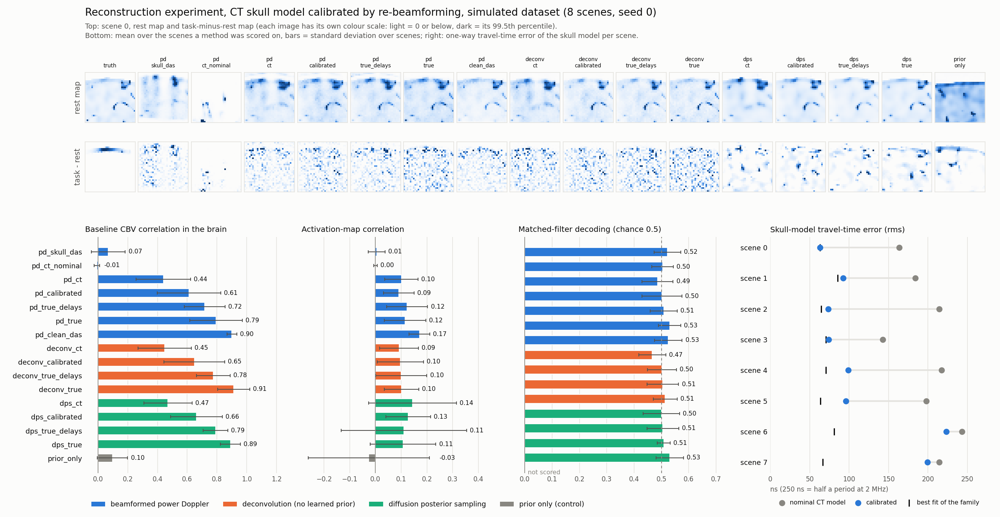
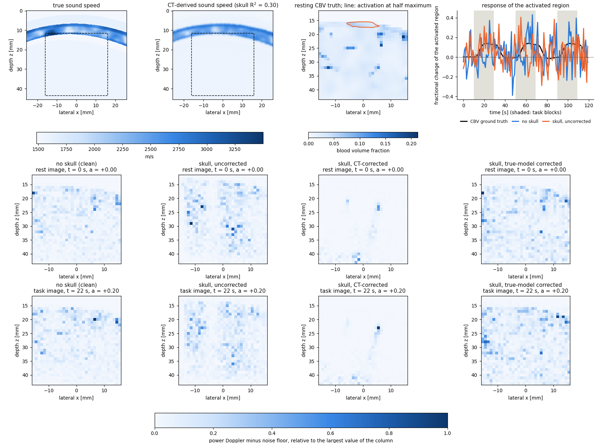

# Results and analysis (for the write-up)

This folder holds everything needed to write up the project as it stands on 17 November 2026: figures, result tables, the trained prior, and this summary. It is a snapshot. The living record is elsewhere: every change and its numbers are in the change log of [`ROADMAP.md`](../ROADMAP.md), every design choice is a numbered decision there (D-001 to D-023), and the status of every physics check is in [`evals/REGISTRY.md`](../evals/REGISTRY.md).

All numbers come from simulation. Nothing here has been compared with real ultrasound data.

## 1. Summary

1. **We built a simulator** of a head, a CT scanner and a transcranial functional-ultrasound (fUS) sensor, driven by one config and one seed, with 72 physics and determinism checks, of which 63 pass. The nine that fail are recorded as failing and explained in section 5.
2. **The skull destroys the uncorrected image.** Across 8 simulated scenes the uncorrected power Doppler image correlates 0.07 with the true blood-volume (CBV) map, against 0.90 with no skull.
3. **A CT-derived skull model helps, and calibrating it against the ultrasound data helps more.** Beamforming with CT-derived delays gives 0.44. After calibration by re-beamforming it gives 0.61, against 0.72 with the true delays. Calibration improved all 8 scenes and closes about 60 % of the gap between CT delays and true delays.
4. **The diffusion prior adds little.** Inverting on top of the beamformer adds a few points, and diffusion posterior sampling (DPS) is within 0.03 of classical deconvolution in every row.
5. **Task activity is not recovered by any method, including the no-skull image.** Decoding accuracy is at chance (about 0.52) everywhere. With realistic speckle, one image is close to a single speckle look.
6. **The calibration is not yet trustworthy.** On scenes built to test it, its focus criterion is not maximised by the true skull model (two evals fail). The positive result in point 3 rests on one dataset.

## 2. What was built

**Head** (`src/neurosim/head`). A procedural 3D head: scalp, three-layer skull (outer table, diploë, inner table), CSF, grey and white matter. The skull has a porosity field. Sound speed, density and absorption follow from it by the mixing law of Aubry et al. (2003); the X-ray properties follow from the same field. A further component of sound speed is added that X-rays cannot see, so that CT is an informative but imperfect predictor of the acoustics (decision D-002). The brain carries a CBV map with vessel-like texture, an activation patch in the cortex, and a block-design task response.

**CT** (`src/neurosim/ct`). Polyenergetic fan-beam CT with Poisson noise and filtered back-projection, calibrated to Hounsfield units, followed by the clinical linear map from HU to acoustic properties.

**fUS forward model** (`src/neurosim/fus`). Everything a medium does to the sound field is stored once per skull as a "Green's bank": the transfer function from each array element to each point, relative to a homogeneous reference (D-006). Blood is a weak scatterer, so signals are linear in it (D-007). Three ways to compute a bank:

| Backend | Physics | Role |
|---|---|---|
| `kwave` | Full wave (k-Wave) | Small-scale reference; about 300 core-hours at full resolution, so not usable for data |
| `bent_ray` | Refracted first-arrival rays from an eikonal solver | **Produces all data** (D-021) |
| `ray` | Straight rays | Fast tests only; wrong beyond about 9 mm off axis at 2 MHz |

On top of a bank: plane-wave channel synthesis, delay-and-sum beamforming against a chosen skull model, SVD clutter filter, power Doppler. Datasets use a fast statistical path in which the expected power Doppler image is linear in CBV and speckle is drawn with a variance derived from blood motion (D-022).

**Reconstruction** (`src/neurosim/recon`). Two designs.

- *First design (superseded).* The unknown skull as one delay and one amplitude per array element, calibrated by blind posterior sampling, with DPS on every image. It failed: this skull model cannot represent the simulated skull.
- *Second design (current, D-023).* The unknown skull as a family of media built from the CT image: the constants of the HU-to-sound-speed map plus 16 smooth lateral modes of extra slowness in bone. The family is calibrated per scene by re-beamforming: maximise the ratio of time-averaged blood power to the beamformer's noise floor, starting from the nominal CT map. Reconstruction (deconvolution or DPS) then works on the average of the rest images and the average of the task images, not on single images.

## 3. Main results

### 3.1 Second design, on corrected data

8 scenes, 120 images each, seed 0. Full table and per-scene numbers: [`experiment_v2/results.md`](experiment_v2/results.md). Figure: [`figures/experiment_v2.png`](figures/experiment_v2.png).

Correlation of the reconstructed resting CBV map with the truth, inside the brain (mean ± standard deviation over the 8 scenes):

| Skull knowledge used | Beamformed image | + deconvolution | + DPS |
|---|---|---|---|
| None (uncorrected) | 0.07 ± 0.11 | | |
| CT delays | 0.44 ± 0.18 | 0.45 ± 0.18 | 0.47 ± 0.16 |
| CT delays, calibrated | 0.61 ± 0.21 | 0.65 ± 0.20 | 0.66 ± 0.17 |
| True delays (oracle) | 0.72 ± 0.14 | 0.78 ± 0.11 | 0.79 ± 0.08 |
| True delays and amplitudes (oracle) | 0.79 ± 0.18 | 0.91 ± 0.11 | 0.89 ± 0.07 |
| No skull | 0.90 ± 0.03 | | |
| Prior only, no measurement (control) | | | 0.10 ± 0.10 |

Skull-model error, as the rms one-way travel-time error over element-pixel pairs (a period at 2 MHz is 500 ns):

| | Mean over scenes |
|---|---|
| Nominal CT model | 197 ns |
| Calibrated | 115 ns |
| Best the model family could do | 71 ns |

- Calibration cut the travel-time error to between 0.34 and 0.52 of its starting value in six scenes and left it almost unchanged (0.92, 0.93) in scenes 6 and 7, which start near half a period of error.
- Signal-to-noise-floor ratio rose 1.3 to 2.1 times in every scene.
- Functional metrics show nothing for any row. Activation-map correlation is at most 0.17 and decoding accuracy is between 0.43 and 0.54 with either decoder, including for the no-skull image (0.17; 0.52 and 0.53).

### 3.2 What the skull does to one scene

[`figures/demo_run_seed0.png`](figures/demo_run_seed0.png): one scene from one config and one seed. Top row: true sound speed, CT-derived sound speed (CT explains 30 % of the variance of true skull sound speed in this scene), true CBV, and the activation time course. Lower rows: one rest and one task image for no skull, uncorrected, CT-corrected and true-model-corrected beamforming.

Two things to read from it. Single images are dominated by speckle, with or without a skull, and the recovered time course is noise around the true response. And the "CT-corrected" panel, which uses the CT model's amplitudes as well as its delays, is nearly empty: those amplitudes are badly wrong (section 5), which is why the second design uses delays only.

### 3.3 First design (superseded, kept as a negative result)

[`experiment_v1_first_design/results.md`](experiment_v1_first_design/results.md), [`figures/experiment_v1_first_design.png`](figures/experiment_v1_first_design.png). This run used the earlier data, which had straight-ray skulls and far too little speckle, so its numbers are not comparable with section 3.1. CBV correlation: no skull 0.91; deconvolution with the true operator 0.71; DPS with the true operator 0.69; true-skull beamforming 0.60; CT-corrected beamforming 0.32; every per-element phase-screen method 0.07 to 0.22. The operator built from the best-fit phase screen differed from the true operator by a relative error of 0.985.

### 3.4 Other figures

- [`figures/head_seed0.png`](figures/head_seed0.png): orthogonal slices of one generated head (tissue labels, sound speed, skull porosity, CBV, activation).
- [`figures/prior_real_vs_samples.png`](figures/prior_real_vs_samples.png): held-out CBV images against unconditional samples from the diffusion prior. Samples have the right boundary, intensity range and texture; vessels come out as blobs and short segments, not long continuous ones.

## 4. Findings about the physics

These came out of building and checking the simulator, and may matter as much as the reconstruction results.

- **CT is a weak predictor of skull sound speed here.** CT-derived sound speed explains 25 to 29 % of the variance of the true skull sound speed on three test seeds (target band from Webb et al. 2018: 23 to 53 %), and 11 to 33 % across the 8 demo scenes of the first dataset. Most of the loss is spatial resolution (0.5 mm CT voxels against 1 to 1.5 mm cortical tables), not noise.
- **Signal level decides everything.** At 2 MHz the skull of the default head costs about 33 dB two-way (measured with the straight-ray backend). At the default noise setting the uncorrected blood signal is about 35 dB under the noise floor. The demo configs use a noise level 30 dB more favourable (D-017), which is an assumption, not a measurement.
- **One image is one speckle look.** Deriving speckle from blood motion gives a typical brain pixel 1.2 to 1.7 independent frames per 200-frame ensemble, not 200, because slow blood barely moves through a resolution cell in 0.4 s. Information about activation is in averages over many images and pixels.
- **Straight rays are not good enough at 2 MHz.** Through a flat 6.5 mm bone slab the straight-ray delay is wrong by up to 0.66 period at the edge of the 128-element aperture. The bent-ray backend is within 0.006 period of the exact refracted time.
- **Full-wave simulation at full resolution is out of reach on a laptop**: about 300 core-hours for 128 elements at 2 MHz.
- **The linear fast path is sound.** A full-wave simulation with a real scatterer behind a bone slab matches the Green's-bank prediction with correlation 0.999997.

## 5. Limits and caveats

**On the positive calibration result**
- It rests on one dataset of 8 scenes. Calibration settings, and the decision to use delays only, were made while looking at scene 0 of that dataset.
- The focus criterion is a brightness, not a coherence. It also rises when a model steers pixels toward where the skull transmits better. On small test scenes whose true sensitivity varies by one to two decades, it is not maximal at the true model and calibration makes the travel-time error worse (E-RECON-013, E-RECON-014 failing).
- The reconstruction is handed things a real system would not have: a speckle-free time-averaged image for the calibration criterion, the true speckle statistics, the true noise level, the true brain mask, and an amplitude match that assumes the simulator's own mean CBV.
- The model's amplitudes are unusable. Bent-ray amplitudes through the CT-derived medium predict a sensitivity wrong by 1.2 decades rms over the brain; the cause is not found.

**On the functional metrics**
- They have no power on this dataset, so nothing can be concluded about recovering task activity. Before changing any method: more averaging per image, more blocks, and a check of whether the head model's blood speeds (median 0.75 mm/s in plane) are realistic.
- The speckle model is biased in both directions. It assumes one velocity per resolution cell, which makes diffuse microvascular blood decorrelate too slowly (pessimistic). It ignores the clutter filter's removal of slow blood, which at 2 MHz is severe: 1 mm/s is a Doppler shift of about 2.6 Hz (optimistic).

**On the simulator**
- Data come from a ray model that keeps only the first arrival: no reverberation, no later arrivals. It is checked against k-Wave only on homogeneous slabs at 0.25 to 0.75 MHz.
- The simulation is 2D for ultrasound, fluid (no shear waves), and the head is a smooth shell without gyri.
- The diffusion prior is small (1.95 M parameters, 15 minutes of CPU training) and trained only on this simulator's procedural CBV maps.
- Many defaults are marked `assumed, to verify` in the configs; decisions D-011, D-014, D-017 and D-023 are choices the team has not yet confirmed.
- Nothing has been run on Windows or macOS, at more than one thread, or at full resolution.

**The nine failing evals** (all left failing on purpose; details in `ROADMAP.md`)

| Eval | What it shows |
|---|---|
| E-FUS-021 | The straight-ray backend misses refracted arrivals (superseded in production by `bent_ray`) |
| E-DATA-002 | The CT-derived skull is about 0.9 mm too thick |
| E-DATA-005 | With realistic speckle, even the no-skull activation time course of one small region does not track the truth |
| E-DATA-007 | Homogenising the skull does not remove aberration, because thickness variation remains |
| E-RECON-001 | The diffusion denoiser beats a linear denoiser by too small a margin at high noise |
| E-RECON-008 | First design: calibration does not recover the skull delays |
| E-RECON-011 | Second design: the fixed-path travel-time shortcut exceeds its error budget for large parameter changes |
| E-RECON-013 | Second design: the focus criterion is not maximal at the true skull model |
| E-RECON-014 | Second design: calibration does not recover the skull on test scenes without model mismatch |

## 6. Provenance and how to reproduce

| Item | Produced by | Code version | Time on 1 core |
|---|---|---|---|
| `figures/head_seed0.png` | `generate_head.py --config configs/head_default.yaml --seed 0`, then `plot_head.py` | `adea41d` | 10 s |
| `figures/demo_run_seed0.png` | `run_pipeline.py --config configs/run_demo.yaml --seed 0 --save-media`, then `plot_run.py` | `adea41d` | 5 min |
| `prior/prior.pt` | `make_prior_dataset.py` and `train_prior.py` with `configs/prior_default.yaml`, seed 0 | `fbfc889` | 3 + 15 min |
| `experiment_v2/` | `make_dataset.py --config configs/sweep_demo.yaml --seed 0` (dataset at `c046eed`), then `run_experiment.py --config configs/recon_default.yaml --seed 0`, then `plot_experiment.py` | `ef4eb6f` plus uncommitted changes, later committed as `30057ea` | 36 + 45 min |
| `experiment_v1_first_design/` | The same scripts with `--design screen`, on the first dataset | `712741e` plus uncommitted changes | 22 + 20 min |

- Exact commands are in the top-level [`README.md`](../README.md). Each `results.json` stores its config, seed and code version.
- The trained prior is committed because its training stopped on a wall-time limit, so its step count (3478) cannot be reproduced from the config alone. To use it, copy `results/prior/prior.pt` to `outputs/prior/prior.pt`.
- The dataset itself (3.8 GB) is not in the repository; regenerate it with `make_dataset.py`.
- The experiment in `experiment_v2/` was run before the final commit. A two-scene re-run with the final code reproduced scenes 0 and 1 exactly; the full 8-scene run has not been repeated from a clean commit.
- All evals and unit tests were re-run from the clean commit `30057ea`: 808 unit tests pass, 63 of 72 evals pass.

## 7. Suggested next steps

In priority order (the full list is under "Open items" in `ROADMAP.md`):

1. Make the functional signal measurable, so that methods can be compared on what the project is about.
2. Replace the brightness criterion by a normalised coherence criterion, and re-run E-RECON-013 and E-RECON-014 unchanged.
3. Find the amplitude error in the CT-derived bent-ray model.
4. Tie the noise level to a measured transcranial sensitivity.

## 8. References

The key references are listed at the end of the top-level [`README.md`](../README.md). Citations that sub-agents wrote from memory and did not check against the source are flagged in the relevant change-log entries of `ROADMAP.md`; check them before citing.
